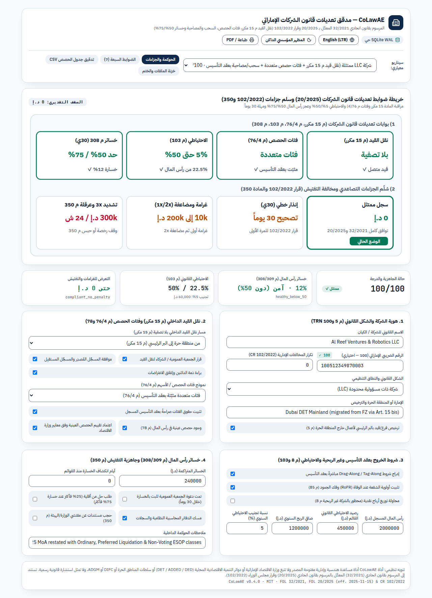
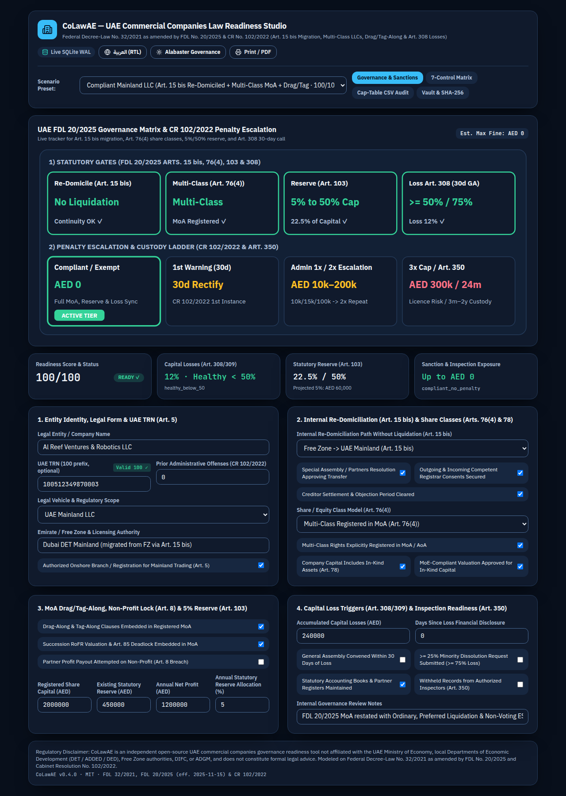
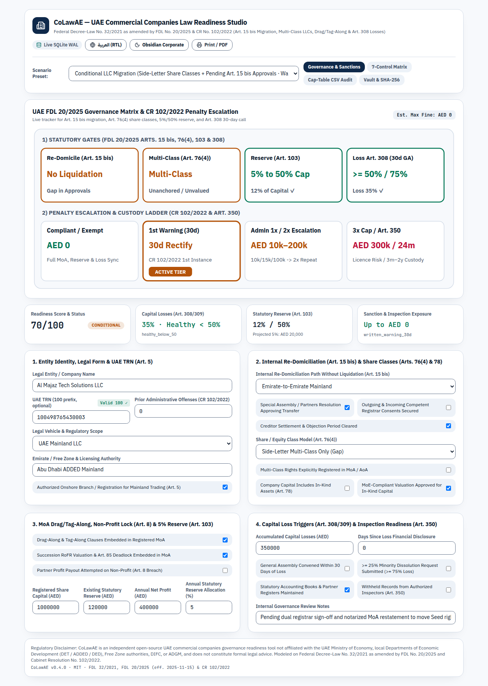
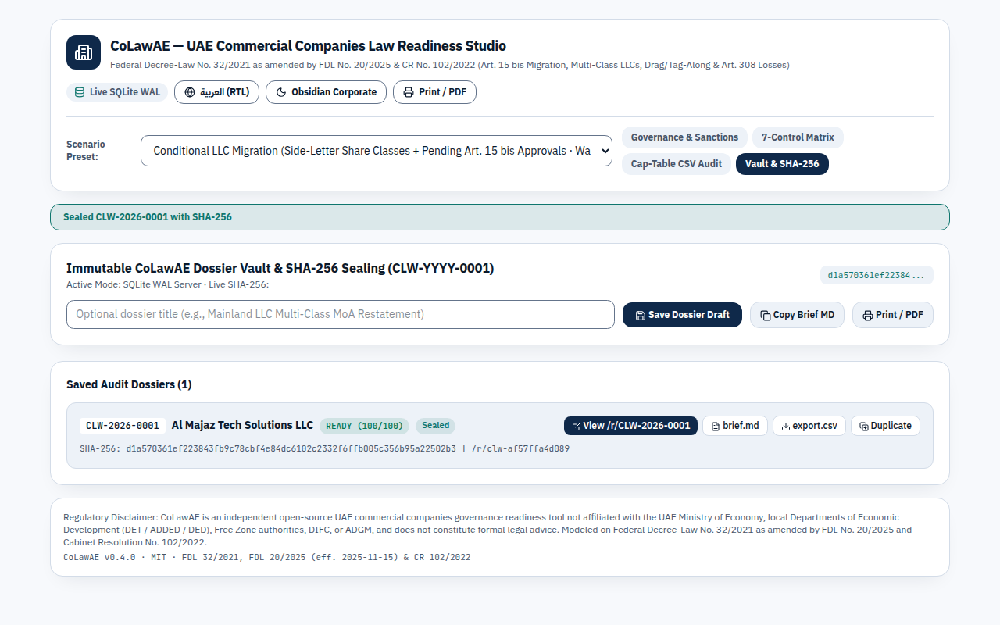
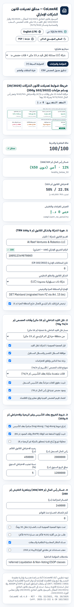
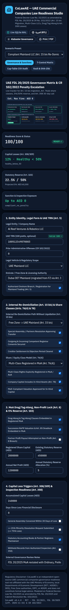

# CoLawAE — مدقق تعديلات قانون الشركات الإماراتي

**UAE Commercial Companies Law (`Federal Decree-Law No. 32 of 2021` as amended by `Federal Decree-Law No. 20 of 2025` effective `2025-11-15` & `Cabinet Resolution No. 102 of 2022`) Article 15 bis Re-Domiciliation, Multi-Class LLC/PrJSC Shares, MoA Drag/Tag-Along & Article 308 Capital Loss Readiness Studio**

[](LICENSE)

> **Regulatory Independence Disclaimer:** `CoLawAE` is an independent open-source corporate governance modeling and operational readiness workbench. It is **not affiliated with, endorsed by, or an official portal of** the UAE Ministry of Economy (`MoE`), Dubai Department of Economy and Tourism (`DET`), Abu Dhabi Department of Economic Development (`ADDED`), any local `DED` or Commercial Registrar, Free Zone authorities, `DIFC`, or `ADGM`, and does not constitute formal legal advice.

---

## Key Capabilities

- **Liquidation-Free Internal Re-Domiciliation (`FDL 20/2025 Art. 15 bis`)**: Verifies legal-personality continuity across `freezone_to_mainland`, `mainland_to_freezone`, `emirate_to_emirate`, and `freezone_to_freezone` transfers alongside special assembly resolutions, outgoing/incoming registrar consents, and creditor clearance.
- **Mainland Scope & Free-Zone Boundary (`FDL 32/2021 Art. 5`)**: Separates onshore-trading free-zone companies (requiring onshore registration/licensing) from exempted within-zone free-zone entities and `DIFC` / `ADGM` vehicles.
- **Multi-Class Equity (`Art. 76(4)`) & In-Kind Valuation (`Art. 78`)**: Checks that `LLC` / `PrJSC` share/quota classes (voting, dividend, liquidation preference, redemption, ESOP) are registered in the notarized Memorandum/Articles (`MoA/AoA`) rather than isolated in side letters, and tracks Ministry-compliant in-kind contribution valuations.
- **MoA Exit, Succession & Non-Profit Controls (`Art. 85`, `Art. 8`, `Art. 103`)**: Models direct `MoA/AoA` anchoring of `Drag-Along / Tag-Along`, deceased-partner `RoFR` succession, deadlock resolution, the **Article 8** non-profit dividend lock, and the **Article 103** **`5%`** annual statutory reserve allocation up to **`50%`** of share capital.
- **Capital Loss Safeguards (`Art. 308 / Art. 309`) & Inspection Readiness (`Art. 350`, `CR 102/2022`)**: Enforces mandatory **`30-day`** General Assembly referral at **`>= 50%`** accumulated losses, tracks **`>= 25%`** minority dissolution rights at **`>= 75%`** erosion, validates 15-digit `100`-prefixed UAE TRNs, and models `CR 102/2022` escalating penalties (`30-day` written warning -> `1x`/`2x`/`3x` up to `AED 300,000` + licence suspension risk) plus `Art. 350` inspector obstruction (`AED 10,000–100,000` / `3m–2y` custody).
- **CWE-1236 Safe Cap-Table CSV Auditor + Dual-Mode Vault**: Audits equity/voting sums (`100%`), neutralizes formula-injection leads (`=`, `+`, `-`, `@`, `|`, `\t`, `\r`), exports `UTF-8 BOM + CRLF` CSVs, seals `CLW-YYYY-0001` dossiers with deterministic `SHA-256` digests, and runs seamlessly on `node:sqlite WAL` or `$0` static browser `localStorage`.

---

## Visual Verification (`Playwright Chrome E2E`)

Verified across desktop (`1280x800`) and mobile (`390x844`) viewports in both Arabic RTL (`Alabaster Governance`) and English LTR (`Obsidian Corporate`).

| Arabic RTL Desktop (`Alabaster Governance`) | English LTR Desktop (`Obsidian Corporate`) | Conditional Migration Gap (`70/100`) |
|---|---|---|
|  |  |  |

| Sealed Dossier (`CLW-2026-0001`) | Mobile Arabic (`390x844`) | Mobile English Obsidian (`390x844`) |
|---|---|---|
|  |  |  |

---

## Quick Start (`Node >= 22`)

```bash
npm install
npm run typecheck
npm test
npm run build
PORT=4253 BASE_PATH= npm start
```

Open `http://127.0.0.1:4253` (defaults to `AR RTL` **Alabaster Governance** theme with instant **English LTR** / **Obsidian Corporate** switching).

### Playwright Headless Chrome E2E

```bash
npm run build
npm run test:e2e
```

Verified across `1280x800` desktop and `390x844` mobile viewports with zero console/page errors, zero horizontal overflow, wire `UTF-8 BOM` CSV downloads, and immutable `/r/:code` public report view tracking.

---

## Core HTTP API (`server/app.mjs`)

- `GET /health`, `GET /readyz` — SQLite `WAL` health and readiness probes
- `GET /api/presets` — Canonical `FDL 32/2021`, `FDL 20/2025` & `CR 102/2022` presets and 7 controls
- `POST /api/evaluate-obligations`, `POST /api/assess` — Statutory evaluation & deterministic `SHA-256` scoring
- `POST /api/audit-captable`, `POST /api/export/captable-csv` — Batch cap-table CSV audit & `CWE-1236`-safe `UTF-8 BOM` export
- `GET/POST /api/profiles`, `GET/PATCH/DELETE /api/profiles/:id` — Company profile CRUD
- `GET/POST /api/dossiers` (and `/api/assessments`), `GET/PATCH/DELETE /api/dossiers/:code`, `POST /duplicate`, `POST /finalize` (`/lock`), `GET /brief.md`, `GET /export.csv`, `GET /summary`
- `GET /api/public/reports/:slugOrCode` — Immutable sealed dossier view with atomic view counter

---

## `$0` & Self-Hosted Deployment

See [`launch/DEPLOY-AND-SHARE.md`](launch/DEPLOY-AND-SHARE.md) for:
1. **`$0` Static Hosting** on Cloudflare Workers Assets (`wrangler.jsonc`)
2. **Docker / `docker compose`** with persistent `node:sqlite WAL` volume (`colawae_data`)
3. **Node 22 + systemd + Caddy + SQLite online backups (`VACUUM INTO`)**
